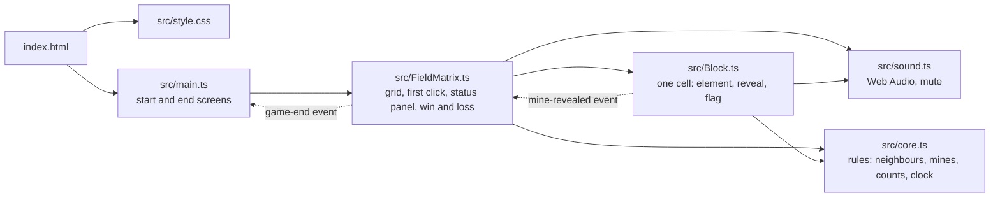

# Architecture

## Modules

- `src/core.ts` owns the rules: neighbour indexes, mine placement, adjacent counts, clock digits which hearts are full, half or empty, when a click on a number may reveal its neighbours (`mayChord`: flags plus revealed mines must equal the number), and the delay of each mine in the game-over wave (`explosionDelays`). It takes plain numbers and returns plain values. A `.agents/VERIFY.py` rule (`core.no-dom`) keeps it DOM-free.
- `src/Block.ts` owns one cell's state and element. Other modules find the cell behind an element with `blockOf(el)`, which reads a `WeakMap`.
- `src/main.ts` owns the start and end screens (native `<dialog>` elements) and the chosen level. A new game calls `stop()` on the old one (no more clock ticks) and replaces `#root` with a fresh element, so the old game's listeners go with it. VERIFIED by e2e: after **Restart** the clock stays at 0; without `stop()` it showed the old game's seconds. The alternative was a teardown method on `FieldMatrix` that removes each listener; replacing the element cannot miss one.
- `src/FieldMatrix.ts` owns the grid, the deferred mine placement on the first click, the status panel and the lives. It counts lives in half hearts (3 hearts = 6); each level in `LEVELS` sets its number of hearts.
- A revealed mine reaches the lives through a bubbling `mine-revealed` DOM event (`MINE_REVEALED` in `Block.ts`), which `FieldMatrix` hears on `#root`. The alternative was passing a callback into every `Block` constructor. The event keeps `Block` unaware of who counts lives, and both sides share one exported constant, so `tsc` checks the name. VERIFIED by e2e: 1 mine → 2½ hearts, 6 mines → locked board, stopped timer, "Game over" screen.
- The end of a game reaches `main.ts` the same way: `FieldMatrix` fires a bubbling `game-end` event (`GAME_END`, detail `{ won, ms }`) once the end animation is over. A game is won when every non-mine cell is revealed, checked by a `#root` click listener after each click. VERIFIED by e2e: with `Math.random` fixed to 0 the Easy board clears in one click, flags all 10 mines and shows "You win!"; **Play again** and **Change level** start fresh boards.

## Why the rules are split out

The rules are the part that can be wrong in ways a player won't notice: a neighbour that wraps across a row, a mine on the first click, or a timer digit that's off. In `core.ts` they run under `bun test` with real inputs and no browser. Typing the original classes as they were would have left them testable only through the DOM.

`blockOf` uses a `WeakMap` and not a `block` property on the element. That way the element keeps its standard `HTMLDivElement` type, and the lookup is checked by `tsc`.

## Game over

`FieldMatrix.gameOver` calls `Block.explode(delay)` on every unrevealed mine. That sets a `--delay` custom property, and the CSS `boom` keyframes run per cell. The alternative was a JS timer per mine. With CSS, the browser schedules all 375 animations itself, and `prefers-reduced-motion` turns them off in one rule. The end screen waits for the wave (`SPREAD_MS + BOOM_MS`) and the lose tune, so the player sees the whole board explode first. VERIFIED by e2e: animations run, all 375 mines end up visible, then the end screen appears. With reduced motion there are no animations and the screen comes right after the tune.

A win runs the same pattern with the `cheer` keyframes on every cell, and `src/confetti.ts` drops 120 pieces in a click-through overlay that removes itself after the last one lands. VERIFIED by e2e: all 81 Easy cells join the wave, 120 pieces fall, the win screen waits for the wave, and the overlay is gone afterwards.

## Sound

`src/sound.ts` owns the `AudioContext` and the mute setting. Other modules only call `play(name, delayMs)`. Every sound is synthesised from oscillators and filtered white noise, so there are no audio files to load, license or cache. The alternative, recorded samples, would need assets and a loader for six short effects. The context is created on the first sound, which always follows a click, so the browser's autoplay policy allows it. Mute is stored in `localStorage` (`minesweeper.muted`). If storage is blocked, the setting simply isn't remembered.

At game over the wave would mean 375 sounds. `waveTimes` bundles the mine delays into one pop per 100 ms instead. The end screen waits for the wave plus the lose tune (`LOSE_TUNE_MS`). VERIFIED by e2e, which counts real `OscillatorNode` and `AudioBufferSourceNode` starts: reveal and flag play, game over starts the boom, the pops and the tune before the end screen, and muting silences everything across a reload.

## Build and serving

Vite builds the site from `index.html` without a config file. VERIFIED with Vite 8.3.4: `vite build` compiles `src/main.ts`, bundles `src/style.css`, embeds the two SVG icons as `data:` URIs, and writes the fonts as hashed files to `dist/assets/`. Vite was chosen on request. Over `bun build` it adds a development server and `vite preview` for serving the build, so the project needs no server code of its own.

`make start` runs `vite build`, then `vite preview` on `PORT`. VERIFIED: it exits cleanly on SIGTERM from `make stop`. The e2e tests run against that served build. Unit tests stay on `bun test`, because `src/core.ts` needs no Vite transforms.

## Deployment

`bun run build` emits relative asset paths (`--base ./`). VERIFIED: a copy of `dist/` served under `/minesweeper/` loads all 2500 cells, the hearts and the fonts with no 4xx responses. So the same artifact works on the GitHub Pages project path and at a root, and e2e tests exactly what gets published. `.github/workflows/pages.yml` deploys only commits whose `verify` workflow passed (`workflow_run`), so a red build never reaches the site.

## Security and privacy

The game stores nothing and sends nothing. The only third-party code is the Ko-fi donation widget, loaded from `storage.ko-fi.com`. The e2e tests tolerate it failing, so the game runs without it.
